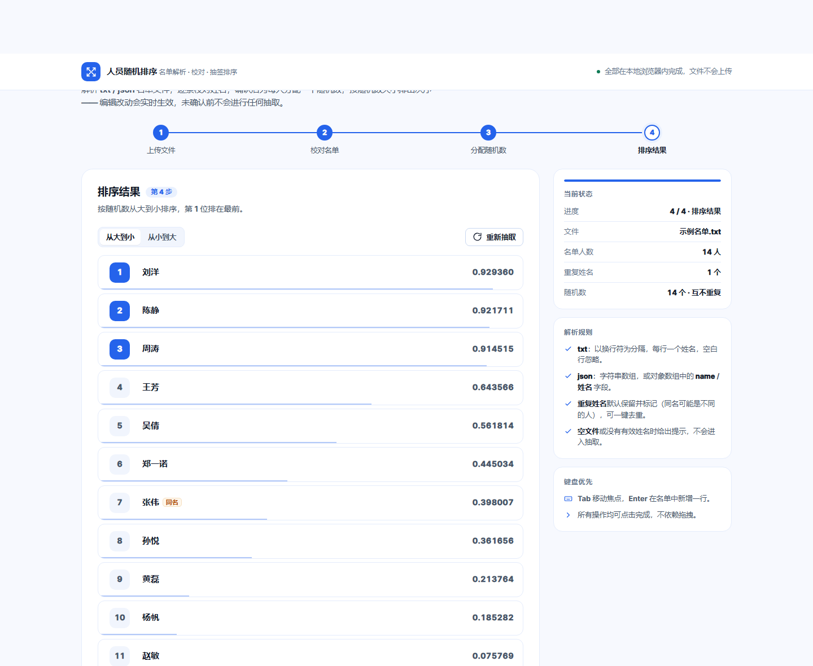

# 人员随机排序

单文件 Web 页面：上传 txt / json 名单 → 解析 → 逐条校对修改 → 确认 → 每人分配随机数 → 按随机数排序并标出次序。

零依赖、零构建、零网络请求：直接双击 `index.html` 就能用，所有解析与随机抽取都在浏览器内存中完成，文件不会上传到任何服务器。



## 快速开始

```text
直接打开  index.html
```

- 想跑交互测试（需要 iframe 跨文档访问，必须走 http 源）：`node tests/serve.mjs`，再访问 <http://127.0.0.1:8137/tests/e2e.html>
- 想跑逻辑单元测试：`node tests/core.test.mjs`（Node 18+，无需安装依赖）

## 本次补全的约定

原需求里留了四处「待补充」，这里给出并实现的选择：

| 待补充项 | 采取的决定 | 理由 |
| --- | --- | --- |
| json 的结构 | 兼容四种写法：`["张三","李四"]` 字符串数组 / `[{"name":"张三"}]` 对象数组 / 对象数组用中文键 `姓名`、`名字` 等 / 外层包一层 `{ data: { list: [...] } }` 这类嵌套数组 | 实际拿到的导出文件格式不统一，多兼容一层就少一次人工整理 |
| 人数是否显式展示 | 显式展示，且在多处出现：上传后「共 N 人」、人数胶囊、右侧状态栏、确认页统计卡、结果页底部 | 抽签场景下「人数对不对」是最关键的校对信号，藏起来等于让人手动数 |
| 重复姓名如何处理 | 默认**保留**并在名单里打「重复 ×2」标记，同时提供「去掉重复」按钮一键处理；确认页和结果页也会提示 | 同名可能是两个不同的人（张伟很常见），静默去重会悄悄吞掉一个参与者；静默保留又会让人以为数据有 bug，所以「保留 + 显式提醒 + 一键处理」 |
| 空行 | 忽略，并统计「忽略 N 行空白」回报给用户 | 从 word / excel 里粘贴出来的名单末尾几乎必有空行 |
| 技术栈 / 交付形式 | 单文件 HTML（原生 JS + CSS，无框架、无构建），附 Node 测试脚本与说明 | 需求是「一个页面」，单文件最省部署成本，双击即用；纯逻辑抽成 `CORE` 模块，可直接被 Node 测试加载 |

## 功能与交互

### 1. 上传与解析

- 拖拽到虚线区域，或点「选择文件」；也支持点击虚线区域任意位置（键盘：Tab 到虚线区内的按钮后回车）。
- 只接受 `.txt` / `.json`，超过 5 MB、空文件、扩展名不符、JSON 语法错误都会就地给出可朗读的错误提示。
- 解析成功后自动进入第 2 步，并提示「已解析 N 人 · 忽略 N 行空白 · 跳过 N 条无效数据」。
- 上传页底部有「载入示例 txt / json」两个快捷入口，方便直接体验。

### 2. 校对与修改

- 姓名直接点开就能改，输入即生效，失焦自动去掉首尾空格。
- 每行右侧显示序号、重复徽标与删除按钮；`Enter` 在当前行后插入一行。
- 「添加人员」追加到末尾；「批量编辑」把整份名单摊到文本框，按行编辑后一次应用（可勾选「应用并去重」）。
- 姓名清空会立刻标红并在行下给出内联错误，「名单无误，下一步」同时禁用 —— 空白姓名不会进入抽取。
- 修改会实时反映到人数、重复计数与右侧状态栏，排序永远基于**修改后**的名单。

### 3. 确认与抽取

- 第 3 步把最终名单铺成 chips 先给人看一眼，再点「开始随机排序」。
- 随机数来自 `crypto.getRandomValues`，范围 `0.000000–0.999999`，同一轮内**互不相同**（碰撞即重抽），不会出现并列名次。
- 未完成确认时抽取函数直接返回，页面上没有任何入口能触发随机分配。
- 回到名单页会作废上一轮结果，必须重新确认才能再抽。

### 4. 结果

- 默认按随机数**从大到小**排序，可切「从小到大」，切换不重新抽取、只换显示方向。
- 每行标出次序徽标（前 3 位高亮）、姓名、随机数，底部一条按数值比例的刻度线辅助直观比较。
- 「重新抽取」换一轮随机数；「复制结果」「导出 txt」输出带次序、姓名、随机数的文本清单。

## 文件结构

```text
random-sort/
├── index.html              # 页面本体（含 CORE 纯逻辑 + UI 两层，CSS 内联）
├── samples/
│   ├── 名单示例.txt        # 含空行、首尾空格、重复姓名
│   └── 名单示例.json       # 含重复姓名
├── tests/
│   ├── core.test.mjs       # 17 条逻辑单测（解析 / 去重 / 随机数 / 排序 / 导出）
│   ├── e2e.html            # 40+ 条交互断言，在浏览器里跑完整流程
│   ├── ui-overflow.html    # 320/375/414/768/1024/1440 × 四个视图的横向溢出检查
│   ├── ui-a11y.html        # 标题层级、可访问名、对比度、焦点可见性检查
│   └── serve.mjs           # 跑上面三个 HTML 用的静态服务器
└── docs/                   # 各步效果图
```

## 测试

```bash
# 1) 逻辑单测（从 index.html 里抽出 /* ==CORE-START== */ 到 /* ==CORE-END== */ 之间的代码求值）
node tests/core.test.mjs
# → 17 passed

# 2) 交互 / 布局 / 无障碍（先起服务器，再用浏览器打开对应页面看输出）
node tests/serve.mjs
# http://127.0.0.1:8137/tests/e2e.html        → 全部 PASS
# http://127.0.0.1:8137/tests/ui-overflow.html → NO-HORIZONTAL-OVERFLOW
# http://127.0.0.1:8137/tests/ui-a11y.html     → 全项 OK
```

本次实测结果：

- 逻辑单测 17/17 通过。
- E2E 全部通过，覆盖：txt 换行切分、空行忽略、重复标记、就地改名、空白行拦截、删行、确认后修改名单进入排序、次序 1..N 连续、随机数互不相同、降序/升序切换、未确认不能抽取、返回修改后结果作废、空文件 / 纯空白 / 错误扩展名提示、JSON 解析与去重、批量编辑。
- 320 / 375 / 414 / 768 / 1024 / 1440 六个宽度 × 四个视图，均无横向滚动。
- 浅色与深色两套主题下，正文、次要文字、徽标、随机数等采样点对比度均 ≥ 4.5:1。

## 设计说明

按 `web-ui-design` 流程，以 ui-ux-pro-max 为设计系统权威（Flat Design / `#2563EB` 主色 / Inter 字体 / 信息密度 7），从 Apple HIG 只借语义色分层、8pt 网格与无障碍底线：

- 语义 token 分层：`--bg / --surface / --label / --label-2 / --border`，深色模式不是反色，而是单独取值并实测过对比度。
- 四步进度条 + 右侧状态栏：任何时候都能看到「第几步、几个人、有没有重复」。
- 全部交互都是点击可达，没有只靠拖拽的操作；拖拽上传只是额外便利。
- `prefers-reduced-motion` 下关闭入场动画与平滑滚动；`aria-live` 播报解析结果、步骤切换与抽取完成。
- 焦点环全程可见（2px 主色 + 2px offset），错误提示用 `role="alert"`，输入错误用 `aria-invalid` + `aria-describedby` 绑定。

参考截图：[上传](docs/preview-upload.png) · [校对](docs/preview-edit.png) · [确认](docs/preview-confirm.png) · [结果](docs/preview-result.png) · [响应式对比](docs/preview-responsive.png)

## 验收对照

| 验收标准 | 实现位置 |
| --- | --- |
| txt 按换行符正确切分 | `CORE.parseTxt`，兼容 `\r\n` / `\r` / BOM / 全角空格 |
| json 按其结构正确解析 | `CORE.parseJson` + `findArray` + `pickNameFromObject` |
| 解析后显示姓名与人数 | 第 2 步名单 + 「共 N 人」/ 人数胶囊 / 右侧状态栏 |
| 用户可修改名单 | 就地编辑、添加、删除、批量编辑、去重 |
| 确认后每人获得随机数 | `CORE.buildDraws`，`crypto.getRandomValues`，互不相同 |
| 最终列表按随机数排序且标次序 | `CORE.rankDraws` + 结果页次序徽标 |
| 空文件 / 无有效人员给提示且不抽取 | 上传错误条 + `state.confirmed` 闸门 |
| 修改后排序基于修改后的名单 | 抽取时读取 `state.people` 当前值 |
| 未确认前不随机分配排序 | `draw()` 首行检查 `state.confirmed` |
